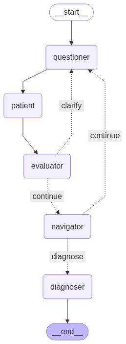

# Structured Clinical Interview and Assessment Agent

An AI system for conducting structured neuropsychiatric assessments through adaptive conversational interviews. This research platform implements graph-based workflow orchestration, LLM-powered clinical reasoning, and automated response classification to support scalable psychiatric evaluation research.

---

## Overview

This system addresses the challenge of automating structured clinical interviews while maintaining diagnostic accuracy and natural conversational flow. The architecture combines conditional branching logic with large language model inference to navigate complex psychiatric assessment protocols. The platform supports both real patient interaction and synthetic patient simulation for model development and validation.

Key capabilities include:
- Graph-based workflow orchestration using LangGraph for complex interview protocols
- LLM-based response classification with fallback heuristics to optimize API usage
- Adaptive question generation for handling ambiguous or incomplete patient responses
- Automated PII/PHI anonymization for privacy protection
- Risk indicator detection for self-harm screening
- Modular JSON-based questionnaire architecture supporting multiple assessment protocols
- Voice interface with speech-to-text and text-to-speech capabilities
- Patient agent simulation mode for systematic testing and model evaluation

---

## System Architecture

### Agentic Workflow

The system implements a state machine as a directed acyclic graph where specialized nodes operate on a shared `InterviewState` object. Conditional edges enable dynamic routing based on classification outcomes and conversation context.



### Node Implementations

**Questioner Node**

Generates contextually appropriate interview prompts using GPT-4. Handles three generation modes:
1. Standard question presentation from module protocol
2. Targeted clarification prompts for ambiguous responses
3. Detailed explanations with clinical examples upon patient request

The node maintains conversation history and question context to ensure coherent follow-up generation.

**Patient Node**

Manages patient input through two operational modes:
- **Simulation mode**: Generates synthetic patient responses using an LLM with patient-specific system prompts encoding demographic information, symptom profiles, and behavioral patterns
- **Interactive mode**: Accepts real-time user input via CLI or web interface

**Evaluator Node**

Performs multi-stage response analysis:
1. **Privacy Protection**: Applies NLP-based named entity recognition (using spaCy) to anonymize PII/PHI
2. **Risk Assessment**: Pattern matching for self-harm indicators requiring immediate escalation
3. **Response Classification**: Determines response category (yes/no/unclear/explanation_request)
   - Rule-based classification for unambiguous affirmative/negative keywords
   - LLM classification for complex or ambiguous responses
   - Configurable threshold (default: 3) for consecutive unclear responses before failsafe classification

**Clarification Handler**

Implements conditional routing logic. Routes conversation back to Questioner node for clarification or explanation, or advances to Navigator node for state updates based on evaluator output.

**Navigator Node**

Manages interview state progression:
- Records structured question-response-classification triples for downstream analysis
- Applies module-defined branching rules to determine next question
- Evaluates termination conditions for module completion
- Triggers diagnostic synthesis when appropriate

**Diagnoser Node**

Synthesizes diagnostic assessment using accumulated interview data. Applies an LLM to generate structured clinical summaries based on DSM-5 criteria or other clinical frameworks encoded in module definitions.

**Persistence Layer**

All conversation logs, intermediate states, and diagnostic outputs are persisted to Redis for session continuity and subsequent analysis. Supports export to structured formats (JSON, CSV) for model evaluation and dataset generation.

---

## Technical Stack

**Backend**
- FastAPI (0.115.2): REST API framework
- LangGraph (0.6.3): Workflow orchestration
- LangChain: LLM integration layer
- OpenAI API (GPT-4): Primary language model
- spaCy (3.7.5): NLP for entity recognition
- Upstash Redis: Session persistence
- Pydantic (2.11.7): Data validation and serialization

**Frontend**
- React with TypeScript
- Vite: Build tooling and dev server
- TailwindCSS: UI styling

**Infrastructure**
- Docker: Containerized deployment
- Uvicorn: ASGI server
- ElevenLabs API: Voice synthesis and recognition

---

## Installation and Setup

### Prerequisites

- Python 3.11+
- Node.js 20+
- Redis instance (Upstash or self-hosted)
- OpenAI API access
- ElevenLabs API key (for voice features)

### Configuration

Create a `.env` file in the project root:

```bash
# Required
OPENAI_API_KEY=sk-...
APP_PASSWORD=your-secure-password
UPSTASH_REDIS_REST_URL=https://...
UPSTASH_REDIS_REST_TOKEN=...
ELEVENLABS_API_KEY=...
ELEVENLABS_VOICE_ID=...

# Optional
FRONTEND_ORIGIN=*
PORT=8000
```

### Local Development

```bash
# Clone repository
git clone https://github.com/yourusername/structured-clinical-interview-agent.git
cd structured-clinical-interview-agent

# Install Python dependencies
pip install -r backend/requirements.txt

# Install frontend dependencies
cd frontend && npm install && cd ..

# Development servers (separate terminals)
# Terminal 1: Backend API with hot reload
uvicorn backend.app.main:app --reload --port 8000

# Terminal 2: Frontend dev server with Vite
cd frontend && npm run dev
```

The Vite dev server proxies API requests to the backend (configured in `frontend/vite.config.ts`).

### Production Deployment

```bash
# Build frontend
cd frontend && npm run build && cd ..

# Run production server (serves API + built frontend)
uvicorn backend.app.main:app --host 0.0.0.0 --port 8000
```

### Docker Deployment

```bash
# Build container
docker build -t structured-clinical-interview-agent .

# Run container
docker run -p 8080:8080 --env-file .env structured-clinical-interview-agent
```

The Dockerfile implements multi-stage builds: Node.js stage for frontend compilation, Python stage for runtime with FastAPI serving both API and static assets.

### Command-Line Interface

```bash
# Interactive interview
python run_interview.py

# Patient simulation mode for testing
python run_interview.py --patient_agent true
```

---

## Project Structure

```
structured-clinical-interview-agent/
├── backend/
│   ├── agent_core/
│   │   ├── interview_agent/
│   │   │   ├── models.py          # Pydantic models and state definitions
│   │   │   ├── nodes.py           # LangGraph node implementations
│   │   │   ├── graph.py           # Workflow graph construction
│   │   │   ├── cli.py             # Command-line interface
│   │   │   └── prompts/           # LLM prompt templates and patient system prompts
│   │   └── utils/                 # Utilities (PII redaction, data processing)
│   ├── app/
│   │   ├── main.py                # FastAPI application
│   │   ├── routers/               # API endpoints (auth, modules, sessions, reports, voice)
│   │   └── session_store.py       # Redis session management
│   └── requirements.txt
├── frontend/
│   ├── src/
│   │   ├── components/            # React components
│   │   ├── pages/                 # Application pages
│   │   ├── services/              # API client
│   │   └── hooks/                 # Custom React hooks
│   └── package.json
├── modules/                       # Clinical interview modules (JSON)
│   ├── module_a.json              # Major Depressive Episode
│   ├── module_b.json              # Major Depressive Episode with Melancholic Features
│   ├── module_c.json              # Manic Episode
│   ├── module_d.json              # Dysthymia
│   ├── module_e.json              # Suicidality
│   └── ...                        # Additional psychiatric assessment modules
├── data/                          # Datasets and data processing scripts
├── notebooks/                     # Jupyter notebooks containing intial concepts
│   ├── evaluation_notebook.ipynb  # Model performance analysis
│   └── figures/                   # Generated visualizations
├── tests/                         # Testing and evaluation scripts
│   ├── eval_patient_agent.py      # Patient agent response evaluation
│   ├── eval_judge.py              # Classifier performance evaluation
│   └── test_diagnosis.py          # Diagnostic accuracy testing
├── patient_agent_results/         # Experimental results and predictions
├── Dockerfile
└── README.md
```

---

## Clinical Module Schema

Each assessment protocol is defined as a JSON module with explicit branching logic. Questions are uniquely identified and contain conditional routing based on classification outcomes.

```json
{
  "module": {
    "id": "A",
    "name": "Major Depressive Episode",
    "description": "DSM-5 criteria assessment for major depressive disorder"
  },
  "questions": [
    {
      "id": "A1a",
      "prompt": "In the past two weeks, have you been feeling sad, depressed, or down most of the day, nearly every day?",
      "context": "Assessing persistent depressed mood (Criterion A1)",
      "next": {
        "yes": "A1b",
        "no": "A2a"
      }
    },
    {
      "id": "A1b",
      "prompt": "When you felt depressed, did these feelings interfere with your ability to function in your daily activities?",
      "next": {
        "yes": "A2a",
        "no": "END"
      }
    }
  ]
}
```

---

## Evaluation and Testing

### Patient Agent Evaluation

The patient agent simulation mode enables systematic testing across diverse synthetic patient profiles. Each profile encodes:
- Demographics (age, gender, occupation)
- Symptom presentation patterns
- Emotional tone and disclosure tendencies
- Expected diagnostic outcomes

```bash
# Run patient agent evaluation
python tests/eval_patient_agent.py
```

Evaluation metrics include response classification accuracy, false positive/negative rates, and conversation coherence scores.

### Classifier Performance

The evaluator node's classification accuracy is assessed across multiple dimensions:
- Inter-rater agreement with human annotations
- Precision/recall for yes/no classifications
- Ability to identify ambiguous responses requiring clarification

```bash
# Evaluate classifier performance
python tests/eval_judge.py
```

### Diagnostic Accuracy

End-to-end diagnostic accuracy is measured by comparing system-generated diagnoses against ground truth labels in the synthetic patient dataset.

```bash
# Test diagnostic accuracy
python tests/test_diagnosis.py
```

### Analysis Notebooks

Jupyter notebooks in `notebooks/` provide:
- Classification accuracy heatmaps across modules and patient characteristics
- F2-score analysis prioritizing recall for clinical sensitivity
- Conversation flow patterns and question-response distributions

---

## Research Applications

This platform supports several research objectives:

1. **LLM Evaluation in Clinical Contexts**: Systematic assessment of language model performance on psychiatric interview tasks with controlled patient simulation
2. **Conversational AI for Healthcare**: Development of adaptive dialogue systems that maintain clinical appropriateness while handling complex branching logic
3. **Automated Screening Tools**: Scalable preliminary assessment systems to augment clinical workflows
4. **Training Data Generation**: Synthetic conversation generation for fine-tuning domain-specific models
5. **Privacy-Preserving NLP**: Methods for automated anonymization of sensitive health information in conversational contexts

---

## Dataset Generation

Interview sessions generate structured datasets suitable for ML model training:

**Conversation logs** (CSV format):
- Question ID, question text, patient response, classification, timestamp
- Full conversation thread with metadata

**Diagnostic summaries** (JSON format):
- Structured assessment outcomes
- Evidence mapping to DSM-5 criteria
- Confidence scores and uncertainty indicators

Synthetic patient simulation enables generation of large-scale labeled datasets with controlled demographic and symptom distributions.

---

## API Endpoints

The FastAPI backend exposes RESTful endpoints:

- `POST /auth/login`: Authentication
- `GET /modules`: List available assessment modules
- `POST /sessions`: Create new interview session
- `GET /sessions/{session_id}`: Retrieve session state
- `POST /sessions/{session_id}/advance`: Submit response and advance interview
- `GET /sessions/{session_id}/report`: Download diagnostic report
- `POST /api/voice/synthesize`: Text-to-speech conversion
- `POST /api/voice/transcribe`: Speech-to-text conversion

Full API documentation available at `/docs` (Swagger UI) when server is running.

---

## Performance Considerations

**LLM API Usage Optimization**:
- Rule-based classification for unambiguous responses reduces API calls by ~40%
- Response caching for repeated clarification patterns
- Batch processing support for patient agent evaluation runs

**Latency**:
- Average question-to-classification cycle: 2-4 seconds
- Patient agent simulation: 3-5 seconds per response
- Diagnostic synthesis: 8-12 seconds for full interview summary

**Scalability**:
- Redis-backed session storage supports concurrent interviews
- Stateless API design enables horizontal scaling
- Frontend build optimized for CDN distribution

---

## Limitations and Considerations

This system is designed for research purposes and preliminary screening applications. Important limitations include:

- Not a replacement for clinical assessment by qualified mental health professionals
- LLM-based classification subject to model biases and errors
- Privacy protections require validation before deployment with real patient data
- Diagnostic outputs should be interpreted as preliminary indicators requiring clinical confirmation
- Performance characteristics derived from synthetic patient data may not fully generalize to real clinical populations
