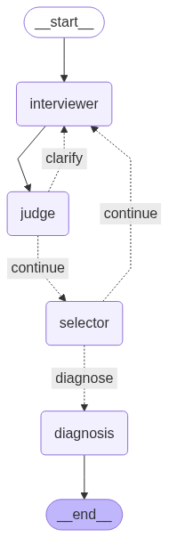

# 🧠 Structured Clinical Interview and Assessment Agent

AI agent for conducting structured neuropyschiatric assessments with dynamic conversation flow, clinical tone, and intelligent follow-ups powered by LLMs.

---

## ✨ Features

- 🧭 **LangGraph workflow:** Conditional branching logic to guide patients through required questions
- 🧠 **LLM judgment:** Yes / No / Unclear classification 
- 🔍 **Smart clarifications:** Targeted follow-ups for ambiguous replies
- 🗂️ **JSON modules:** Questionnaire logic with explicit branching paths
- 🗣️ **Clinical tone:** Natural, professional conversation style
- 🧾 **Full logging:** Trace every prompt, response, and decision
- 🧪 **Patient Agent mode:** Simulate patient behavior for testing and demos
- 🚨 **Red flag detection**: Identify potential self-harm risk based on responses

---

## 🚀 Quick Start

### 💻 Local Development

**Prerequisites:**
- Python 3.8+
- Node.js 18+ and npm
- OpenAI API key

**Setup:**
```bash
# Clone the repository
git clone https://github.com/yourusername/structured-clinical-interview-agent.git
cd structured-clinical-interview-agent

# Install dependencies
pip install -r requirements.txt

# Add your OpenAI key to a .env file
echo "OPENAI_API_KEY=sk-proj-your-api-key-here" > .env
```

**Run Options:**

**Web App (FastAPI serves Vite build):**
```bash
# Build the frontend (generates frontend/dist)
cd frontend
npm install
npm run build
cd ..

# Run only the backend (serves both API and the built frontend)
uvicorn backend.app.main:app --host 0.0.0.0 --port 8000 --reload

# Open the app
# http://localhost:8000
```

**Dev workflow (recommended):**
- Run API: `uvicorn backend.app.main:app --reload`
- Run frontend with hot reload: `cd frontend && npm run dev`
  - Vite proxy (see `frontend/vite.config.ts`) forwards `/auth`, `/modules`, `/sessions`, `/healthz` to the API on `http://localhost:8000`.

**Command Line Interface:**
```bash
python run_interview.py
```

**Patient Agent Mode (for testing):**
```bash
python run_interview.py --patient_agent true
```

---

## 🔄 Workflow

The system is a directed graph of coordinated nodes that share a single `InterviewState`.

### Graph



### Walkthrough

1. **Questioner Node**

   * Presents the next question with an LLM.
   * If the previous reply was ambiguous, generates a focused clarification prompt.
   * If the previous reply was request for more explanation, generates a detailed explanation for question and add 
     an example if applicable.

2. **Patient Node**

   * Receives the questioner’s question.
   * Either simulates a patient reply via LLM (automated mode) or accepts user input (manual mode).

3. **Evaluator Node**

   * Reviews the patient’s response.
   * Anonymize PII/PHI to protect privacy.
   * Raise a red flag for potential self-harm risk.
   * If the answer is clearly yes or no without extra context, classifies locally without an LLM call.
   * Otherwise calls an LLM to return one of: `yes`, `no`, `rephrase needed`, `explain request`, `red flag`.
   * Optional failsafe: after three consecutive ambiguities, classify as `yes` to break loops. This threshold is configurable.

4. **Clarification Handling**

   * If the evaluator requests clarification, route back to the questioner to ask a clearer question.
   * Otherwise continue to selection.

5. **Navigator Node**

   * Logs question, response, and classification.
   * Advances to the next question using module branching logic.
   * Flags completion or readiness for diagnosis.

6. **Diagnoser Node**

   * Compiles all responses and criteria.
   * Uses an LLM to produce a structured diagnostic summary.

7. **End**

   * Saves diagnostic results and the full conversation log for review.

**Input modes**

* 🧪 **Patient Agent:** Automated simulation via LLM and a system prompt.
* ⌨️ **Manual:** Interactive CLI input from the user.

---

## 📦 Project Structure

```
structured-clinical-interview-agent/
├── interview_agent/          # Core package
│   ├── models.py             # Data models and InterviewState
│   ├── nodes.py              # LangGraph nodes (questioner, evaluator, etc.)
│   ├── graph.py              # Workflow construction
│   └── cli.py                # Command-line interface
├── modules/                  # Interview questionnaire modules
│   ├── module_a.json         # Major Depressive Episode
│   ├── module_d.json         # ... other modules
├── run_interview.py          # Entry script
└── requirements.txt          # Dependencies
```

### 🧩 Module JSON schema (example)

```json
{
  "module": {
    "id": "A",
    "name": "Major Depressive Episode"
  },
  "questions": [
    {
      "id": "A1a",
      "prompt": "Question text...",
      "next": {
        "yes": "A1b",
        "no": "A2a"
      }
    }
  ]
}
```

---

## ⚙️ Configuration

Environment variables:

* `OPENAI_API_KEY` (required): OpenAI API key
* `APP_PASSWORD` (required): Determines the login password needed to access the app
* `UPSTASH_REDIS_REST_URL` (required): Redis URL required to run app
* `UPSTASH_REDIS_REST_TOKEN` (required): Redis token required to run app
* `ELEVENLABS_API_KEY` (required): ElevenLabs API Key for audio support
* `ELEVENLABS_VOICE_ID`: ID of ElevenLabs voice that audio will be read with

---


